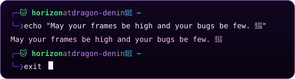

 

<!-- Social & Support Badges -->

  
  
  
  
  

<!-- Featured Projects -->
<table align="center">
  <tr>
    <td align="center" width="340">
      <a href="https://ez-pp.farm"><b>⚔️ EZPPFarm</b></a> 
      osu! private server with custom PP calculations &amp; leaderboards
    </td>
    <td align="center" width="340">
      <a href="https://osu.direct"><b>🌸 osu.direct</b></a> 
      Fast public beatmap mirror &amp; search API
    </td>
  </tr>
</table>

 

<!-- Tech Stack -->

  
  
  
  
  
  
  

<!-- GitHub Stats -->

  
  

<!-- Spotify Status -->

  

 

<!-- Starship Terminal Sign-off -->

  

